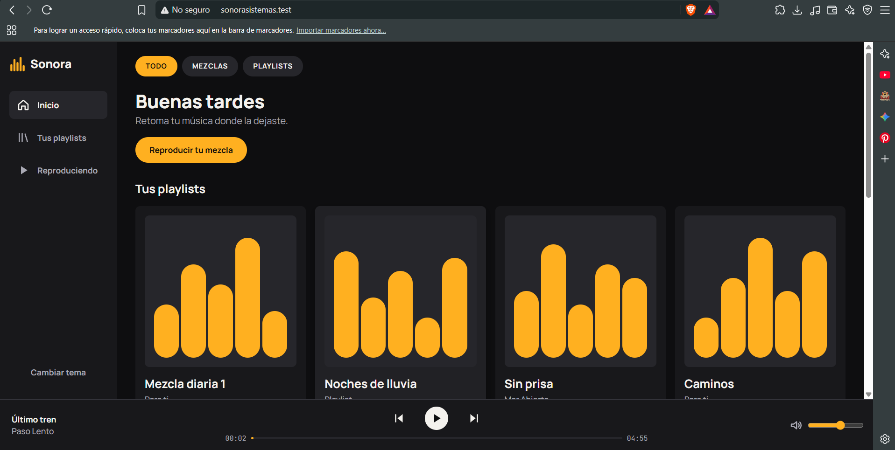
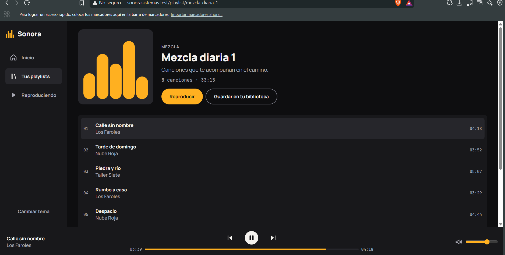
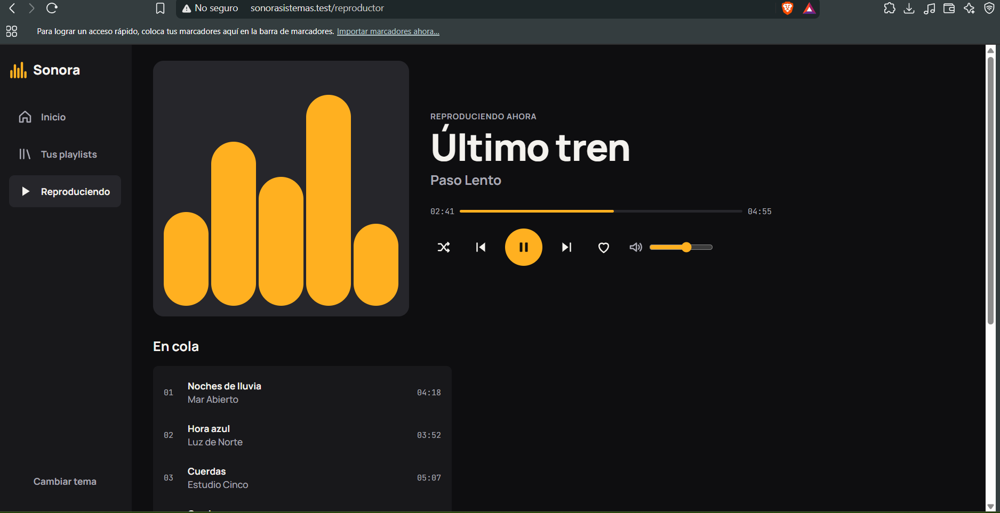
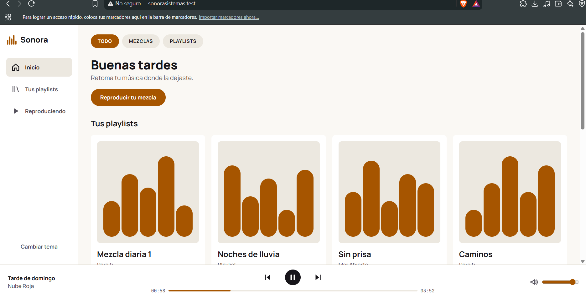
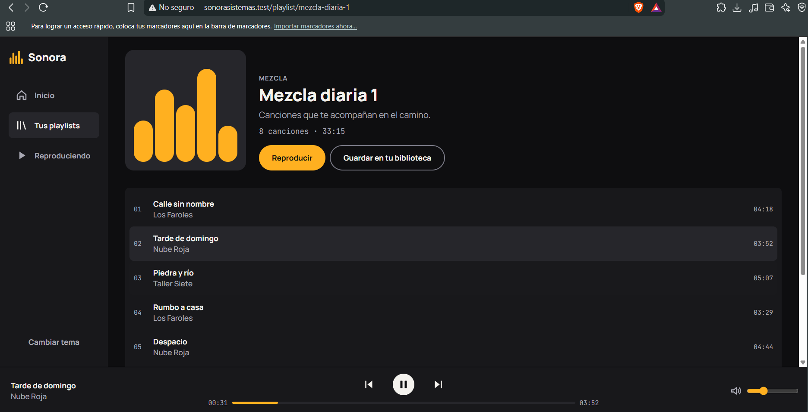

# Sonora (Laravel + Tailwind CSS v4)

Aplicación web de música con reproducción simulada (sin audio), construida con el sistema de diseño Sonora.
Pantallas: **Inicio**, **Playlist** y **Reproductor**, con navegación entre ellas, tema oscuro/claro y versión móvil.

## Cómo ejecutarlo

Requisitos: PHP 8.2+, Composer y Node 20+ (con Laravel Herd ya está todo).

1. Clona el repositorio y entra a la carpeta:
   `git clone https://github.com/SrSoloX/sonora.git && cd sonora`
2. Instala las dependencias:
   `composer install` y `npm install`
3. Prepara el entorno:
   `cp .env.example .env` (en PowerShell: `copy .env.example .env`)
   `php artisan key:generate`
   `php artisan migrate`
4. Ejecuta el proyecto (dos terminales):
   `npm run dev` y `php artisan serve`
5. Abre http://localhost:8000

## Estructura

| Archivo | Para qué sirve |
| --- | --- |
| `routes/web.php` | Rutas `inicio`, `playlist/{slug}` y `reproductor` |
| `app/Http/Controllers/SonoraController.php` | Un método por pantalla |
| `app/Support/Catalogo.php` | 10 canciones y 4 playlists inventadas |
| `resources/css/app.css` | Tokens del sistema (color, tipografía, radios, sombra) conectados a Tailwind |
| `resources/js/app.js` | Reproductor simulado, tema, chips, teclado en la barra de progreso |
| `resources/views/layouts/app.blade.php` | Estructura común: navegación, contenido y barra del reproductor |
| `resources/views/components/` | `button`, `chip`, `media-card`, `song-row`, `icon`, `icon-button`, `play-button`, `portada`, `progreso`, `volumen`, `player-bar`, `nav-link`, `logo` |

## Accesibilidad

- Anillo de enfoque de 3px (utilidad `foco`) en todos los controles; todo se usa con teclado.
- Botones de solo icono con `aria-label`; botones de alternar con `aria-pressed`; enlace "Saltar al contenido".
- La barra de progreso es un `role="slider"`: flechas ±5 s, Inicio y Fin.
- Estados con texto e icono ("Guardado"), no solo color.

## Fase 2 opcional: canciones desde la base de datos

```bash
php artisan make:model Track -ms
```

Migración (`up`): `$t->id(); $t->string('titulo'); $t->string('artista'); $t->string('album'); $t->unsignedInteger('dur'); $t->timestamps();`
En el seeder, inserta las canciones de `Catalogo::pistas()` con `Track::create([...])` y cambia `Catalogo::pistas()` por `Track::all()->toArray()`.









